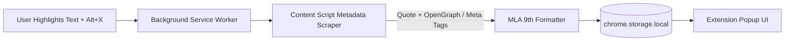

# CiteSnap

[](LICENSE)
[](manifest.json)
[](#privacy--data-handling)
[](#features)
[](#why-citesnap)

A local-first Chrome extension that captures highlighted webpage quotes via `Alt + X` and automatically formats MLA 9th Edition in-text citations and Works Cited bibliographies.

> **Hackathon Submission:** Built and submitted for the **Teens Hack Houston Hackathon** (November 2026).

---

## Why CiteSnap

Academic research in the browser typically requires switching between source tabs, manually extracting author and publication metadata, and formatting bibliographies in external tools—often behind accounts, ads, or paywalls.

CiteSnap keeps the workflow inside the active tab: highlight a passage, press `Alt + X`, and copy a formatted MLA 9th Edition citation or export a compiled Works Cited list without sending browsing data to external servers.

## Features

- **One-Keystroke Capture (`Alt + X`):** Captures the active text selection alongside page title, canonical URL, site name, author, and publication date metadata.
- **MLA 9th Edition Formatting:** Generates both parenthetical in-text citations and hanging-indent Works Cited entries, handling missing authors or dates according to MLA conventions.
- **Local-First Persistence:** Stores all captured quotes and bibliography entries locally in `chrome.storage.local` with zero accounts, tracking, or cloud sync.
- **Containerless Minimalist UI:** Built on a clean `#fbfbfd` canvas with hairline dividers for low-friction review, inline editing, and one-click clipboard copy.
- **Current Scope & Limitations:** CiteSnap captures and stores the exact quote text and source URL, but does not yet automatically scroll to or highlight the captured passage when reopening a saved source link.

## Architecture



## Installation (Developer Mode)

1. Clone this repository:
   ```bash
   git clone https://github.com/Sabarish369/citesnap.git
   cd citesnap
   ```
2. Open Google Chrome and navigate to `chrome://extensions`.
3. Enable **Developer mode** using the toggle in the top-right corner.
4. Click **Load unpacked** and select the root `citesnap` directory.
5. *(Optional)* Pin **CiteSnap** to your Chrome toolbar for quick access to your Works Cited list.

## Usage

1. Navigate to any article, journal page, or web source.
2. Highlight the text passage you want to cite.
3. Press **`Alt + X`** (or click the CiteSnap toolbar icon) to capture the quote and extract page metadata.
4. Open the CiteSnap popup to review the generated **MLA 9th Edition** entry, edit any missing fields, or copy the formatted Works Cited entry to your clipboard.

### Customizing the Keyboard Shortcut

If `Alt + X` conflicts with another extension or OS shortcut:

1. Open `chrome://extensions/shortcuts`.
2. Locate **CiteSnap** in the list.
3. Click the pencil icon next to **Capture highlighted quote** and assign your preferred key combination.

## Repository Structure

```text
citesnap/
├── manifest.json          # Manifest V3 configuration & minimal permissions
├── background.js          # Keyboard shortcut listener & storage coordination
├── content.js             # Selection capture & DOM/OpenGraph metadata extraction
├── popup/
│   ├── popup.html         # Extension popup layout
│   ├── popup.css          # Containerless #fbfbfd UI styling
│   └── popup.js           # Bibliography rendering, editing & clipboard export
├── utils/
│   └── mla-formatter.js   # Pure functions for MLA 9th Edition citation rules
└── assets/
    └── icons/             # Extension icons (16x16, 48x48, 128x128)
```

## Privacy & Data Handling

- **Permissions:** Requests only `activeTab`, `storage`, and `scripting` to read the user-triggered selection on the current tab and save entries locally.
- **Zero Telemetry:** No analytics scripts, external API calls, or remote databases are used. Clearing extension storage permanently removes all saved citations.

## References & Technical Documentation

CiteSnap was built using the following official web standards, browser APIs, and citation guidelines:

- **Citation Style Standard:** Modern Language Association of America. *MLA Handbook*. 9th ed., Modern Language Association of America, 2021. ([MLA Style Center](https://style.mla.org/))
- **Extension Architecture:** Google Chrome Developers. *Chrome Extensions Manifest V3 Documentation*. ([developer.chrome.com/docs/extensions/develop/migrate/what-is-mv3](https://developer.chrome.com/docs/extensions/develop/migrate/what-is-mv3))
- **Keyboard Shortcut Handling:** Google Chrome Developers. *`chrome.commands` API Reference*. ([developer.chrome.com/docs/extensions/reference/api/commands](https://developer.chrome.com/docs/extensions/reference/api/commands))
- **Local-First Persistence:** Google Chrome Developers. *`chrome.storage` API Reference*. ([developer.chrome.com/docs/extensions/reference/api/storage](https://developer.chrome.com/docs/extensions/reference/api/storage))
- **Active Tab & Selection Injection:** Google Chrome Developers. *`chrome.scripting` & `activeTab` Permission Reference*. ([developer.chrome.com/docs/extensions/reference/api/scripting](https://developer.chrome.com/docs/extensions/reference/api/scripting))
- **Structured Metadata Extraction:**
  - The Open Graph Protocol. *Open Graph Metadata Specification (`og:title`, `og:site_name`, `article:author`, `article:published_time`)*. ([ogp.me](https://ogp.me/))
  - WHATWG. *HTML Living Standard — Standard Metadata Names (`author`, `description`, `canonical`)*. ([html.spec.whatwg.org](https://html.spec.whatwg.org/multipage/semantics.html#standard-metadata-names))
  - Schema.org. *`Article` & `ScholarlyArticle` JSON-LD Vocabulary*. ([schema.org/Article](https://schema.org/Article))
- **Text Selection & Clipboard APIs:**
  - W3C. *Selection API (`window.getSelection`)*. ([w3c.github.io/selection-api](https://w3c.github.io/selection-api/))
  - W3C. *Clipboard API and Events (`navigator.clipboard.writeText`)*. ([w3c.github.io/clipboard-apis](https://w3c.github.io/clipboard-apis/))


